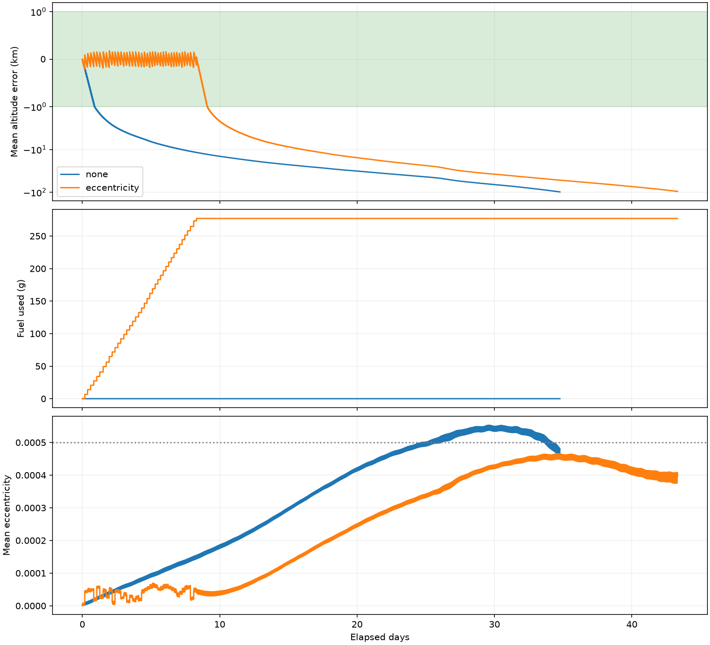

# CubeSat drag compensation and low-thrust orbit maintenance in GMAT

How much lifetime can a small resistojet add to a satellite at 300 km, and which controller spends the propellant effectively?

This educational Python + NASA GMAT project models a 30 kg satellite at 300 km and 45 degrees inclination. It compares native GMAT controllers and audits propellant use, orbit-maintenance accuracy, heater energy, and lifetime to a common 200 km altitude endpoint.

The public example uses **15 mN, 67 s, 20 W and 277 g propellant**, selected from published CHIPS-180 warm-gas specifications. It is an independent simplified study, not a manufacturer-validated product model. See [public parameters and assumptions](PUBLIC_PARAMETERS.md).

## Example result

In one historical-weather replay, the unpowered spacecraft reached the 200 km study endpoint after **34.76 days**, compared with **43.33 days** under eccentricity-aware control: **8.56 additional days using 277 g**, or about **30.92 days/kg consumed** for this particular case. Propellant ran out on day **8.31**; subsequent unpowered coast contributes to endpoint lifetime. Fueled mean-altitude RMS error was **81.7 m**.

These are simulated case results, not guaranteed lifetime gains or a scaling law. See [the full report](results/lifetime/REPORT.md), [validation](results/VALIDATION.md) and [assumptions](PUBLIC_PARAMETERS.md).



## What you can explore

* Uncontrolled decay versus deadband, periodic, feedforward PI, adaptive deadband, and eccentricity-aware maintenance.
* Atmospheric drag with historical space weather, J2 gravity and Sun/Moon perturbations.
* Synthetic navigation latency/noise/outages, pointing error and illustrative heater dynamics.
* Finite-thrust mass depletion, coast after fuel exhaustion, and paired lifetime extension per kilogram actually consumed.
* Native altitude, eccentricity and thrust XY plots, plus a 3D OrbitView.

Dynamics, control and actuator logic execute inside GMAT. Python generates scripts, runs cases and analyzes results; the GMAT Python API is not required.

## Quick start

Install NASA GMAT separately. The tested native implementation uses Windows GMAT R2022a with MSISE90. R2026a supports NRLMSISE00 for batch studies; newer visualization objects differ. GMAT binaries are not included.

```sh
python -m venv .venv
# Activate the virtual environment using your shell's normal command.
python -m pip install -r requirements.txt
```

Supply a CSSI space-weather file (see [data instructions](data/README.md)). Generate a GUI mission with the three XY plots and OrbitView:

```sh
python gmat_model.py --out runs/gui --weather data/SpaceWeather-All-v1.2.txt --days 60 --displays
```

Open `runs/gui/mission.script` in GMAT R2022a and run it. Altitude is geodetic km; eccentricity is Brouwer short-period mean; thrust is N, zero during heater-only operation. Elapsed time is in days. The controller maintains mean altitude, which differs from instantaneous geodetic altitude.

Run a paired lifetime study:

```sh
python study.py --install /path/to/GMAT --out runs/lifetime --weather data/SpaceWeather-All-v1.2.txt --days 180 --controllers none eccentricity
```

Use your actual installation path, such as `C:/GMAT`, on Windows. Paths are generated for the current computer; regenerate scripts after moving the project. You can alternatively set `GMAT_HOME`.

Compare all included controllers:

```sh
python study.py --install /path/to/GMAT --out runs/controllers --weather data/SpaceWeather-All-v1.2.txt --days 2 --controllers none deadband periodic feedforward_pi adaptive_deadband eccentricity
```

Outputs include `REPORT.md`, JSON metrics, CSV histories and a comparison figure. Two-day comparisons demonstrate behavior; they do not establish completed mission lifetimes. If either lifetime endpoint is not reached, extend the simulation rather than interpreting a censored result as an exact extension.

## Controller logic

All nonzero modes use the same finite-burn heater/actuator constraints: assumed minimum hot duration 300 s, maximum 600 s, minimum coast 600 s and nominal anticipated warmup 240 s. Fuel availability caps the final burn. Controllers use delayed/noisy mean elements and a lagged weather predictor rather than future truth. See the implementation in `gmat_model.py`.

* **Deadband:** trigger orbit raising when estimated mean altitude falls below the lower threshold.
* **Periodic:** accumulate estimated drag impulse and schedule correction each orbital period.
* **Feedforward PI:** combine estimated drag compensation with proportional/integral altitude feedback, anti-windup and accumulated impulse credit.
* **Adaptive deadband:** adjust the trigger using estimated decay and warmup/burn lead time.
* **Eccentricity-aware:** apply phase gating to the feedback command, with a low-altitude override, to limit eccentricity growth.

MPC and ideal continuous throttling are not included. This is orbital energy/eccentricity maintenance, not full ground-track or inclination stationkeeping.

## Limitations and provenance

The thermal model is illustrative and is not a CHIPS hardware characterization. A 200 km endpoint is not reentry. Historical-weather replay does not establish future reliability, flight readiness, endurance or guaranteed thrust margin. Controller settings require tuning and independent verification before operational use. See [PUBLIC_PARAMETERS.md](PUBLIC_PARAMETERS.md).

NASA GMAT is a separate dependency with its own terms. This repository links to manufacturer information and does not redistribute manufacturer datasheets, logos, GMAT binaries, or the third-party weather dataset. Original tutorial code is MIT licensed.

Useful references: [NASA GMAT samples](https://github.com/nasa/GMAT/tree/main/application/samples), especially `Ex_LEOStationKeeping.script` and `Ex_FiniteBurn.script`.

## Contributing

Useful contributions include independent reproduction, atmosphere/epoch sensitivity, navigation-model improvements, numerical convergence checks, and controller comparisons. For a reported discrepancy, include GMAT/Python versions, parameters, weather-file hash, seed, and a minimal case. See [CONTRIBUTING.md](CONTRIBUTING.md).

## Render a synchronized video

The renderer uses actual GMAT Cartesian states and telemetry. It produces a labeled accelerated replay, not a recording of the GMAT GUI. Generate and run a short telemetry case, then render:

```sh
python gmat_model.py --out runs/video --weather data/SpaceWeather-All-v1.2.txt --days 1 --telemetry
python run_gmat.py runs/video/mission.script --install /path/to/GMAT
python render_video.py runs/video/telemetry.txt runs/orbit-maintenance.mp4
```

The video shows Earth-centered inertial motion, mean altitude, mean eccentricity and actual commanded thrust, with an enlarged spacecraft marker. The 3D Earth is a spherical visual reference. Native GUI XY altitude is geodetic; the replay uses mean altitude to show controller tracking clearly.
